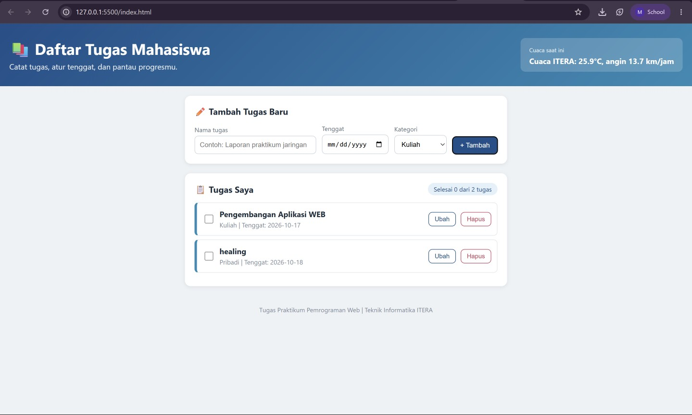

# Daftar Tugas Mahasiswa

Aplikasi dashboard sederhana untuk mencatat tugas mahasiswa. Tugas dikelompokkan ke tiga kategori, yaitu Kuliah, Organisasi, dan Pribadi, supaya kebutuhan akademik dan kegiatan di luar kelas tidak tercampur. Data tersimpan di `localStorage` sehingga tidak hilang saat halaman ditutup. Di bagian atas ada cuaca real-time untuk daerah ITERA.

## Fitur

- Tambah tugas (nama, tenggat, dan kategori Kuliah, Organisasi, atau Pribadi)
- Ubah nama tugas
- Hapus tugas
- Centang tugas yang sudah selesai
- Ringkasan jumlah tugas selesai
- Cuaca ITERA dari Open-Meteo API
- Data tersimpan di localStorage
- Tampilan responsif untuk layar HP

## Cara Menjalankan

Simpan `index.html`, `style.css`, dan `app.js` dalam satu folder, lalu buka `index.html` di browser.

## Screenshot

## Fitur ES6+ yang Digunakan

Semua nomor baris merujuk ke file `app.js`.

- **const**: baris 2, 24, 37, 44, 74 sampai 76. Dipakai untuk nilai yang tidak diubah.
- **let**: baris 105. Variabel `finished` yang nilainya bertambah di dalam perulangan.
- **Arrow function**: baris 44, 47, 54, 60, 88, 106, 119. Dipakai pada `find`, `map`, `filter`, `forEach`, dan event listener.
- **Template literal**: baris 77, 93 sampai 101, 109. Dipakai untuk teks cuaca, HTML tiap tugas, dan ringkasan.
- **Async/await**: baris 71 sampai 81. Fungsi `loadWeather()` mengambil data cuaca dengan `fetch`.
- **Class**: baris 5 (`TaskItem`) dan baris 16 (`DashboardApp`). `TaskItem` memodelkan data tugas, `DashboardApp` mengelola aplikasi.
- **Destructuring pada parameter fungsi**: baris 88. `({ id, title, deadline, category = 'Kuliah', done }) =>` pada `render()`.
- **Destructuring pada objek**: baris 76. `const { temperature, windspeed } = ...`.
- **Default value**: baris 88. `category = 'Kuliah'` untuk data lama yang belum punya kategori.
- **Spread operator**: baris 38, 47, 54. Memperbarui array dan objek tanpa mengubah aslinya.
- **localStorage**: baris 24 (`getItem`) dan baris 32 (`setItem`).

## Sumber API

- Cuaca: `https://api.open-meteo.com/v1/forecast?latitude=-5.36&longitude=105.31&current_weather=true`