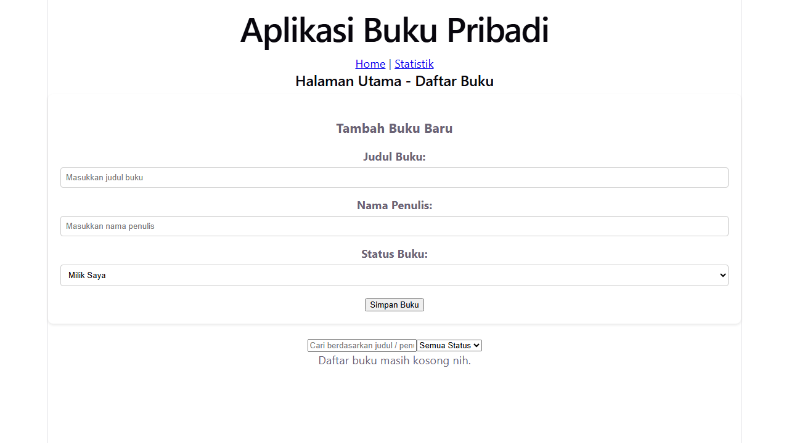
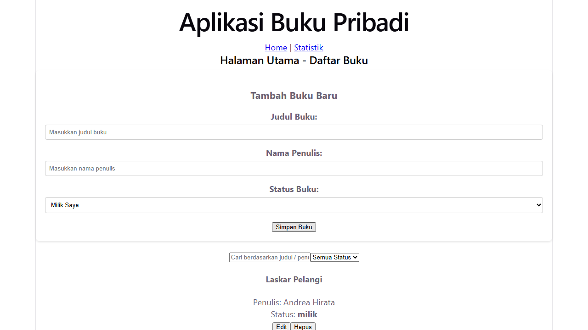
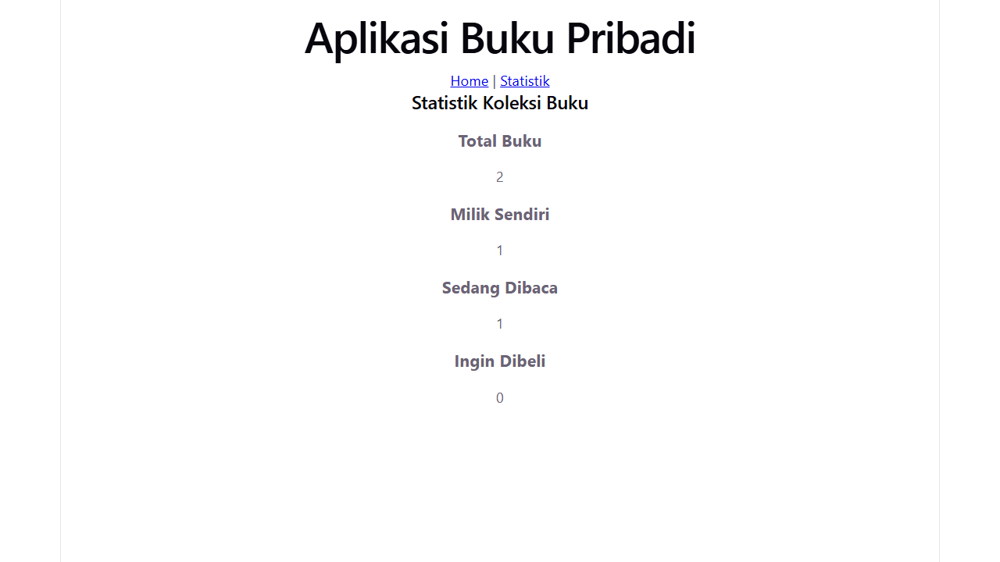

# Aplikasi Manajemen Buku Pribadi (Alfath Atha Muhana_124140032_pertemuan3)

## Deskripsi Aplikasi
Aplikasi web berbasis React yang dirancang untuk membantu pengguna mencatat dan mengelola daftar buku pribadi. Pengguna dapat melacak buku yang sudah dimiliki, buku yang sedang dibaca, serta buku yang ingin dibeli di masa mendatang.

## Fitur Utama
1. **Tambah Buku**: Form untuk mencatat judul buku, penulis, dan status (Milik, Sedang Baca, Ingin Beli).
2. **Edit & Hapus Buku**: Memperbarui informasi buku atau menghapusnya dari daftar.
3. **Filter & Pencarian**: Menyaring buku berdasarkan status dan mencari judul/penulis secara real-time.
4. **Statistik Buku**: Halaman khusus untuk melihat ringkasan jumlah buku berdasarkan kategori.
5. **Persistensi Data**: Menggunakan `localStorage` agar data tetap tersimpan saat halaman dimuat ulang.

## Instruksi Instalasi dan Menjalankan Aplikasi
1. Buka terminal pada folder project:
   ```bash
   cd "Alfath Atha Muhana_124140032_pertemuan3"
   ```
2. Pasang dependensi yang diperlukan:
   ```bash
   npm install
   ```
3. Jalankan server pengembangan (development server):
   ```bash
   npm run dev
   ```
4. Buka URL yang tertera di terminal (biasanya `http://localhost:5173`).

## Menjalankan Unit Test
Untuk menjalankan pengujian unit dengan Vitest & React Testing Library:
```bash
npm test
```

## Penjelasan Fitur React yang Digunakan
- **useState & useEffect**: Digunakan dalam form manajemen state lokal dan sinkronisasi penyimpanan `localStorage`.
- **Context API**: `BookContext` menyediakan state global untuk operasi CRUD buku tanpa *prop drilling*.
- **React Router (`react-router-dom`)**: Mengatur navigasi multi-halaman antara Beranda (`/`) dan Statistik (`/stats`).
- **Custom Hooks**:
  - `useLocalStorage.js`: Mengelola interaksi dengan browser `localStorage`.
  - `useBookStats.js`: Menghitung statistik ringkasan buku.
- **PropTypes**: Memastikan validasi tipe props pada seluruh komponen.

## Laporan Testing
Pengujian unit telah berhasil dijalankan menggunakan Vitest dengan 5 skenario pengujian utama:
1. Validasi form input kosong (menampilkan pesan error).
2. Pengiriman form data valid.
3. Render daftar buku beserta aksi edit dan hapus.
4. Interaksi filter status dan pencarian.
5. Perhitungan statistik buku melalui custom hook `useBookStats`.

```bash
 RUN  v5.0.5 D:/tugas/PAW/praktikum PAW 3/Alfath Atha Muhana_124140032_pertemuan3

 ✓ src/__tests__/BookApp.test.jsx (5)
   ✓ Pengujian Aplikasi Manajemen Buku (5)
     ✓ Menampilkan pesan error jika judul dan penulis kosong
     ✓ Berhasil submit form saat input diisi
     ✓ Menampilkan list buku dan tombol hapus
     ✓ Filter memanggil fungsi perubahan text
     ✓ useBookStats menghitung jumlah status buku

 Test Files  1 passed (1)
      Tests  5 passed (5)
   Start at  12:49:25
   Duration  1.32s
```

## Screenshots Antarmuka



