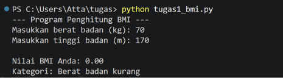
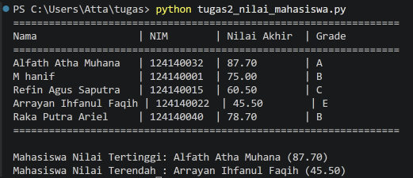
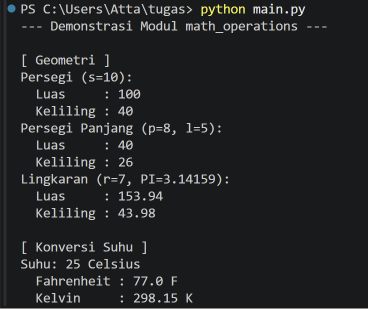

# Laporan Praktikum Pertemuan 4
**Nama:** Alfath Atha Muhana  
**NIM:** 124140032

## Deskripsi Program
1. **tugas1_bmi.py**: Menghitung Body Mass Index (BMI) berdasarkan input berat (kg) dan tinggi (m). Menampilkan kategori status berat badan.
2. **tugas2_nilai_mahasiswa.py**: Mengelola data akademik mahasiswa (Nama, NIM, UTS, UAS, Tugas). Menghitung nilai akhir tertimbang, menentukan grade A-E, dan mencari nilai ekstrem.
3. **math_operations.py**: Modul kustom berisi fungsi geometri (persegi, persegi panjang, lingkaran), konversi suhu (C ke F/K), dan konstanta PI.
4. **main.py**: Program utama yang mendemonstrasikan penggunaan modul `math_operations` dengan berbagai metode import.

## Cara Menjalankan
Pastikan Python telah terinstal, lalu jalankan perintah berikut di terminal:

```bash
# Menjalankan tugas 1
python tugas1_bmi.py

# Menjalankan tugas 2
python tugas2_nilai_mahasiswa.py

# Menjalankan main program
python main.py
```

## Bukti Eksekusi





### Detail Teks Terminal

### Tugas 1: BMI
```text
Masukkan berat badan (kg): 70
Masukkan tinggi badan (m): 1.75

Nilai BMI Anda: 22.86
Kategori: Berat badan normal
```

### Tugas 2: Nilai Mahasiswa
```text
=================================================================
Nama                 | NIM        | Nilai Akhir  | Grade
=================================================================
Alfath Atha Muhana   | 124140032  | 87.70        | A    
M hanif              | 124140001  | 75.00        | B    
Refin Agus Saputra   | 124140015  | 60.50        | C    
Arrayan Ihfanul Faqih | 124140022  | 45.50        | E    
Raka Putra Ariel     | 124140040  | 78.70        | B    
=================================================================

Mahasiswa Nilai Tertinggi: Alfath Atha Muhana (87.70)
Mahasiswa Nilai Terendah : Arrayan Ihfanul Faqih (45.50)
```

### Tugas 3: Modul Matematika (main.py)
```text
--- Demonstrasi Modul math_operations ---

[ Geometri ]
Persegi (s=10):
  Luas     : 100
  Keliling : 40
Persegi Panjang (p=8, l=5):
  Luas     : 40
  Keliling : 26
Lingkaran (r=7, PI=3.14159):
  Luas     : 153.94
  Keliling : 43.98

[ Konversi Suhu ]
Suhu: 25 Celsius
  Fahrenheit : 77.0 F
  Kelvin     : 298.15 K
```
