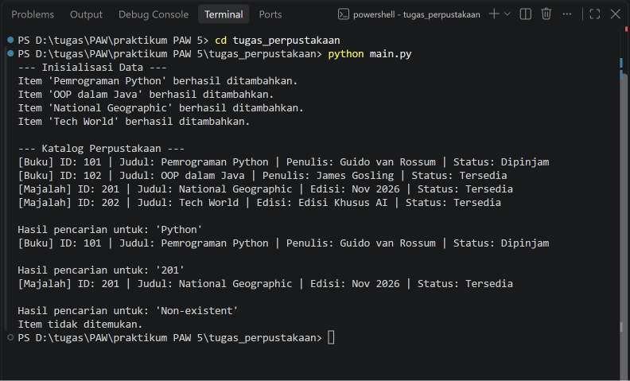

# Sistem Manajemen Perpustakaan (Tugas PAW Pertemuan 5)

## Identitas Mahasiswa
- **Nama**: Alfath Atha Muhana
- **NIM**: 124140032
- **Kelas**: RA

## Deskripsi Program
Program ini adalah sistem manajemen perpustakaan sederhana berbasis Command Line Interface (CLI) yang mengimplementasikan 4 pilar Object-Oriented Programming (OOP) dalam Python:

1. **Class & Object**: Penggunaan class `LibraryItem`, `Book`, `Magazine`, `Member`, dan `Library`.
2. **Inheritance**: Class `Book` dan `Magazine` mewarisi abstract class `LibraryItem`.
3. **Encapsulation**: 
   - Protected member (`_title`, `_item_id`) pada `LibraryItem`.
   - Private member (`__koleksi`) pada class `Library`.
   - Property decorator (`@property` dan `@setter`) untuk status peminjaman.
4. **Polymorphism**: Method `get_detail()` di-override pada subclass `Book` dan `Magazine`.

## Struktur Direktori
```text
Alfath Atha Muhana_124140032_pertemuan5/
├── latihan/
│   ├── 01_everything_is_object.py
│   ├── 01_procedural_vs_oop.py
│   ├── 02_class_object.py
│   ├── 03_inheritance.py
│   ├── 04_encapsulation.py
│   ├── 05_polymorphism.py
│   └── 06_abstract_class.py
├── tugas_perpustakaan/
│   ├── library_item.py
│   ├── member.py
│   ├── library.py
│   ├── main.py
│   └── output.png
├── README.md
└── .gitignore
```

## Panduan Menjalankan Program
1. Buka terminal pada folder `tugas_perpustakaan/`.
2. Jalankan perintah:
   ```bash
   python main.py
   ```

## Screenshot Output Eksekusi Terminal



```text
--- Inisialisasi Data ---
Item 'Pemrograman Python' berhasil ditambahkan.
Item 'OOP dalam Java' berhasil ditambahkan.
Item 'National Geographic' berhasil ditambahkan.
Item 'Tech World' berhasil ditambahkan.

--- Katalog Perpustakaan ---
[Buku] ID: 101 | Judul: Pemrograman Python | Penulis: Guido van Rossum | Status: Dipinjam
[Buku] ID: 102 | Judul: OOP dalam Java | Penulis: James Gosling | Status: Tersedia
[Majalah] ID: 201 | Judul: National Geographic | Edisi: Nov 2026 | Status: Tersedia
[Majalah] ID: 202 | Judul: Tech World | Edisi: Edisi Khusus AI | Status: Tersedia

Hasil pencarian untuk: 'Python'
[Buku] ID: 101 | Judul: Pemrograman Python | Penulis: Guido van Rossum | Status: Dipinjam

Hasil pencarian untuk: '201'
[Majalah] ID: 201 | Judul: National Geographic | Edisi: Nov 2026 | Status: Tersedia

Hasil pencarian untuk: 'Non-existent'
Item tidak ditemukan.
```
